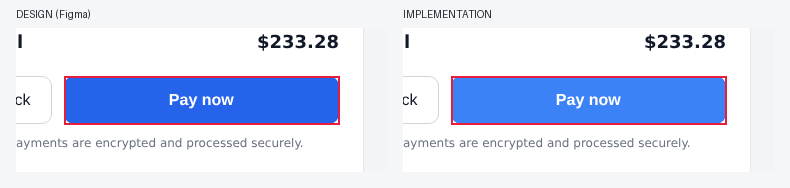

# [CRITICAL] Color differs: button.btn-primary "Pay now"

**Screen:** Checkout
**Element:** button.btn-primary "Pay now"
**Category:** color  |  **Severity:** critical  |  **Agent confidence:** 90%

| | Value |
|---|---|
| Expected (design) | background #2563EB |
| Actual (implementation) | background #3B82F6 |

**Why:** Measured: Figma spec vs computed CSS (rules).

**Location:** x=760, y=499, 275x48 px (design coordinates)
**Automated checks:** pixel evidence: regions [8]; color difference confirmed in pixels

_Opened by the Design QA agent (DQA-001) after human approval. Evidence attached._

