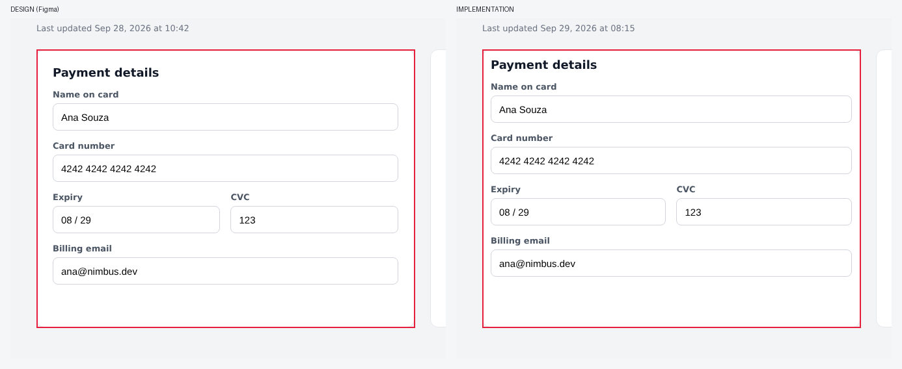

# [MAJOR] Spacing differs: section.card

**Screen:** Checkout
**Element:** section.card
**Category:** spacing  |  **Severity:** major  |  **Agent confidence:** 90%

| | Value |
|---|---|
| Expected (design) | padding 24px |
| Actual (implementation) | padding 12px |

**Why:** Measured: Figma spec vs computed CSS (rules).

**Location:** x=40, y=182, 581x428 px (design coordinates)
**Automated checks:** pixel evidence: regions [3, 4, 5, 6, 7]

_Opened by the Design QA agent (DQA-002) after human approval. Evidence attached._

